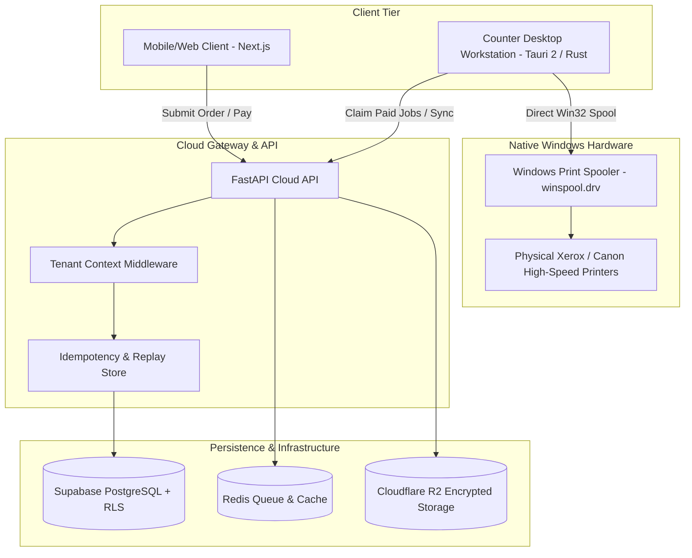

# Architecture & System Design Documentation

## Phase 0 executable foundation (2026-10-22)

Root Cargo workspace contains `packages/printplan/rust` and `tools/printer-proof`;
legacy Tauri app is excluded. No cloud migration or production API change occurred.
Shared JSON Schema + Python/TS/Rust adapters normalize/hash the same immutable
render recipe. The CLI validates tenant test context and bounded source digest,
then creates an exclusive durable per-shop/job intent before isolated native work.
Native process loads a hash-checked PDFium DLL from an absolute path, rehashes owned
PDF bytes, validates page count/geometry and driver capabilities/private DEVMODE,
then rasterizes through GDI. Copies/imposition order has one software owner.
Parent supervises timeout; observation/submission never certifies physical output.
Explicit simulator emits no hardware evidence. Exact Microsoft Print To PDF driver
has a separately scoped virtual output profile; physical driver coercion stays strict.

Actual local virtual output was generated through Windows, parsed and visually
inspected. Real physical printer gate remains BLOCKED. Root app scaffold defects
remain documented in PHASE0_REPOSITORY_REVIEW and are not repaired by this proof.
See PHASE0_RUNBOOK, PHASE0_IMPLEMENTATION_RESULTS and ADR 0002 for evidence/limits.

> Phase 0 inspection (2026-10-22): the diagram and claims below describe the legacy
> scaffold, not verified production behavior. X-Tenant-ID is not authentication;
> physical printer integration and zero-duplicate guarantees are not established.
> Latest contract requires INR paise, server-derived shop scope, FOSS-first Valkey/
> storage and COMPLETION_UNKNOWN without automatic reprint. See
> [proposed Phase 0 design](superpowers/specs/2026-10-22-phase0-design.md),
> [proposed ADR](ADRs/0001-phase0-truth-and-isolated-proof.md) and
> [acceptance status](ACCEPTANCE_CRITERIA.md). Phase 0 is incomplete.

## System Overview
The Xerox / PrintFlow SaaS platform is a unified cloud-and-edge printing ecosystem designed for retail print shops, university copy centers, and commercial reprographics franchises.

## Security & Multi-Tenancy Architecture
1. **Tenant Separation**:
   - `X-Tenant-ID` header required on all operational endpoints.
   - Database Row-Level Security (RLS) ensures SQL queries cannot cross tenant boundaries.
2. **Idempotency & Zero Double-Charge Guarantee**:
   - Webhook events validated with HMAC-SHA256 signatures with 300-second replay rejection window.
   - Transactional deduplication via unique `(tenant_id, event_id)` records.
3. **Hardware Reconciliation**:
   - Local journal records physical spool submission before communicating status back to cloud.
   - Zero duplicate print dispatch across power outages or network reconnects.
