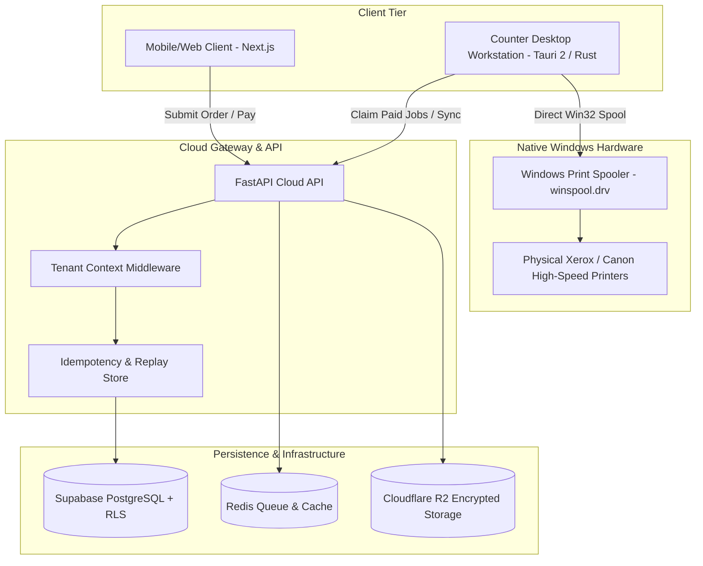

# Architecture & System Design Documentation

## System Overview
The Xerox / PrintFlow SaaS platform is a unified cloud-and-edge printing ecosystem designed for retail print shops, university copy centers, and commercial reprographics franchises.

## Security & Multi-Tenancy Architecture
1. **Tenant Separation**:
   - `X-Tenant-ID` header required on all operational endpoints.
   - Database Row-Level Security (RLS) ensures SQL queries cannot cross tenant boundaries.
2. **Idempotency & Zero Double-Charge Guarantee**:
   - Webhook events validated with HMAC-SHA256 signatures with 300-second replay rejection window.
   - Transactional deduplication via unique `(tenant_id, event_id)` records.
3. **Hardware Reconciliation**:
   - Local journal records physical spool submission before communicating status back to cloud.
   - Zero duplicate print dispatch across power outages or network reconnects.
