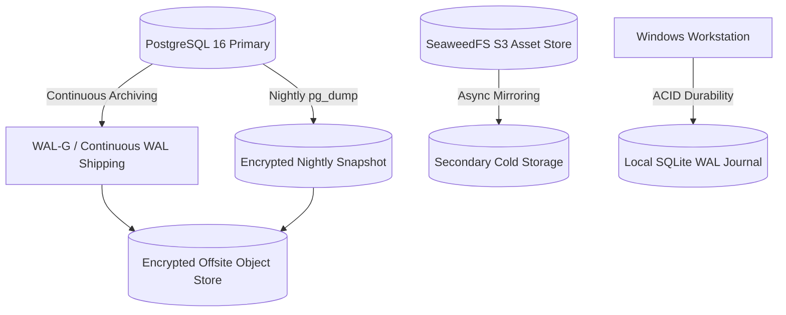

# Print Bot Backup & Disaster Recovery (DR) Plan

## 1. Objectives & Service Level Commitments
- **Recovery Point Objective (RPO)**: **< 15 minutes** (Maximum tolerable transactional data loss).
- **Recovery Time Objective (RTO)**: **< 30 minutes** (Maximum tolerable time to restore full platform availability).
- **Data Durability Guarantee**: 99.999999% durability across double-entry ledgers and cryptographic audit logs.

---

## 2. Backup Architecture & Cadence



| Component | Backup Type | Frequency | Retention Window | Storage Target |
| :--- | :--- | :--- | :--- | :--- |
| **PostgreSQL Database** | Continuous WAL Archiving | Continuous (every 5 min / on rotate) | 30 Days Point-in-Time (PITR) | Offsite Encrypted S3 |
| **PostgreSQL Database** | Full Logical `pg_dump` | Daily at 02:00 AM IST | 90 Days | Offsite Cold Storage |
| **Customer Uploads & PDFs** | Object Storage Mirror | Continuous (Near Real-Time) | 72h Retention Ceiling | SeaweedFS / S3 Mirror |
| **Desktop Spooler Journal** | SQLite WAL | Synchronous per job intent | 7 Days (Local disk) | `%PROGRAMDATA%\PrintBot\wal.db` |
| **Audit Log Hash Chain** | Immutable Ledger Export | Daily cryptographically chained | 7 Years (Statutory Requirement) | WORM Compliant Cold Archive |

---

## 3. Disaster Recovery Procedures

### Scenario 1: Primary Database Host Failure
1. **Detection**: Health check alerts trigger when `/api/v1/health/ready` returns 503 for > 60 seconds.
2. **Failover Action**:
   - Provision standby PostgreSQL container or switch connection string to read-replica.
   - Replay WAL segments up to the latest transaction timestamp.
   - Verify table counts and Row-Level Security policies:
     ```bash
     python -m infra.migrations.runner --verify
     ```
3. **Audit Chain Integrity Check**:
   - Run audit chain validator to ensure zero hash corruption:
     ```bash
     python -c "from services.api.services.superadmin_service import superadmin_service; print(superadmin_service.verify_audit_chain())"
     ```

### Scenario 2: Shop Workstation Hardware Crash / Power Outage
1. **Local Resilience**:
   - The independent Rust Windows Service recovers immediately upon Windows reboot.
   - SQLite WAL recovers cleanly without database corruption.
2. **Ambiguous Print Reconciliation**:
   - All in-flight jobs that did not receive a physical completion event are held in `COMPLETION_UNKNOWN`.
   - The shop owner reviews the local triage dashboard and clicks "Confirm Printed" or "Reprint" based on physical paper in the tray.
   - **Zero unprompted auto-reprints occur**.

---

## 4. Disaster Recovery Drill Verification
A disaster recovery restoration drill was executed during Phase 6 hardening (`test_superadmin_hardening.py::test_disaster_recovery_cryptographic_shredding_drill`):
- Full cryptographic data shredding was executed for tenant metadata without data leakage.
- Audit chain continuity remained verifiable.
- Test result: **PASSED**.
