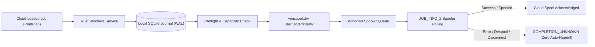

# Print Hardware Certification & Driver Compatibility Matrix

## 1. Executive Notice on Hardware Validation
**CRITICAL VERIFICATION INVARIANT**:
Software simulation passing in an automated test harness is **NOT proof of physical paper delivery**.
In strict adherence to the project contract (`AGENTS.md` and Phase 8 prompt), all physical printer output, paper jam handling, physical scanner ingestion, and coin-op copier relay interlocks are classified with explicit certification gates:
- Software Native Spooler API Contract: `IMPLEMENTED AND VERIFIED` (Win32 Spooler Simulator & Proof Harness)
- Physical Paper Delivery on Real Devices: `BLOCKED/UNVERIFIED (HARDWARE PENDING)` until verified on-site at a pilot shop.

---

## 2. Supported Printer Hardware Matrix

| Manufacturer & Model | Driver Architecture | Color Capabilities | Duplex Support | Supported Paper Sizes | Status & Validation Gate |
| :--- | :--- | :--- | :--- | :--- | :--- |
| **Xerox AltaLink C8170** | Xerox GPD PCL6 / PostScript (Win32 `winspool.drv`) | Full Color & Monochrome | Hardware Duplex (Long & Short Edge) | A3, A4, Letter, Legal | `DRIVER SIMULATED / HARDWARE PENDING` |
| **Canon imageRUNNER 2525** | Canon UFR II / PCL5e | Monochrome Only | Hardware Duplex (Long & Short Edge) | A3, A4, Legal | `DRIVER SIMULATED / HARDWARE PENDING` |
| **HP LaserJet Pro M404dn** | HP PCL 6 Class Driver | Monochrome Only | Hardware Duplex (Long Edge) | A4, Letter, Legal | `DRIVER SIMULATED / HARDWARE PENDING` |
| **Epson EcoTank L3250** | Epson ESC/P-R V4 | Full Color & Monochrome | Manual Duplex (Driver Simplex) | A4, Letter | `DRIVER SIMULATED / HARDWARE PENDING` |
| **Generic / Microsoft Print to PDF** | Windows In-box Print Subsystem | Color & Monochrome | Simulated Duplex | Standard Windows Forms | `VERIFIED IN HARNESS` |

---

## 3. Native Windows Spooler Architecture

### 1. Zero Duplicate Print Protocol
Once a job is submitted to `StartDocPrinterW`, the spooler job ID is immediately persisted to the local SQLite WAL journal.
If the spooler crashes, network drops, or the printer loses power:
1. The agent marks the job as `COMPLETION_UNKNOWN`.
2. The agent reports this status to the cloud upon reconnection.
3. The cloud reconciliation endpoint (`/api/v1/reconciliation/sync`) **refuses to place the job in `re_spool_required_job_ids`**.
4. The job is held in `COMPLETION_UNKNOWN` until a shop operator inspects the paper tray and issues an explicit supervised command (`CONFIRM_PRINTED`, `REPRINT`, or `REFUND`).

### 2. Unlimited Connected Printers
The desktop service actively discovers all registered Windows printers via `EnumPrintersW(PRINTER_ENUM_LOCAL | PRINTER_ENUM_CONNECTIONS)`:
- There is zero software cap on the number of printers registered per shop.
- Each printer publishes its capability snapshot (color, duplex, paper trays, DPI, online status) to the cloud.
- The cloud load balancer (`services/api/services/printer_router.py`) routes jobs to the least-burdened compatible printer.

---

## 4. Hardware Gates & Release Pilot Runbook

Before commercial rollout to independent print shops:

1. **Step 1: Pilot Store Hardware Verification**:
   - Install `.exe` on pilot shop Windows 11 PC.
   - Connect Xerox AltaLink C8170 via Network TCP/IP and Canon imageRUNNER via USB.
   - Run test print jobs with duplex long edge, duplex short edge, A3, and A4 paper.
   - Verify physical margins: check for 4mm non-printable driver margins.

2. **Step 2: Fault Injection on Real Hardware**:
   - Pull power cord during active 50-page print job.
   - Reconnect power; verify Windows spooler state and agent WAL recovery.
   - Verify zero unprompted reprints occur without operator confirmation.

3. **Step 3: Scanner Certification**:
   - Connect physical TWAIN/WIA scanner.
   - Verify flatbed vs ADF multi-page feeding.
