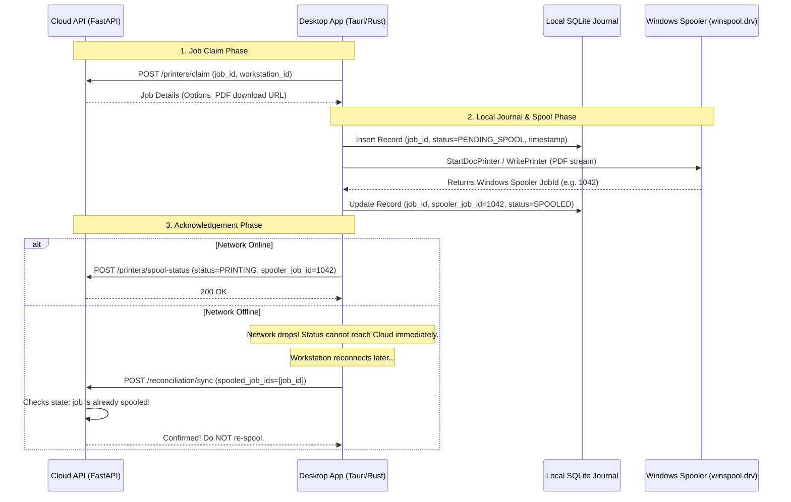

# Safe Print Spool Reconciliation Protocol

## The Problem
When a desktop workstation prints high-volume customer orders, two catastrophic edge cases frequently occur in legacy print shops:
1. **Network Drop During Spooling**: The local printer physically starts printing, but the network connection drops before the cloud API can be updated. When the workstation comes back online, a naive cloud system resends the job, causing an accidental, costly **duplicate print**.
2. **Workstation Crash / Power Outage**: The counter PC reboots mid-shift. Without a local persistent journal, unprinted or half-printed jobs may be permanently lost.

## The Solution: Two-Phase Local Spool Journaling & Cloud Reconciliation

