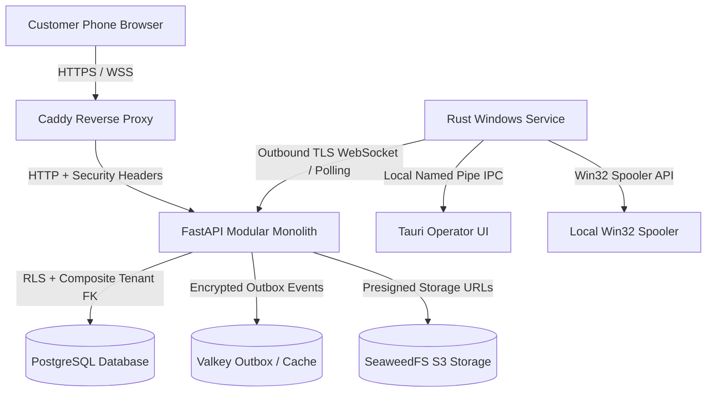

# Print Bot Security & Privacy Assessment Report

## 1. Scope & Objective
This report provides a comprehensive defensive security audit and privacy assessment for the **Print Bot** multi-tenant printing platform. The assessment evaluates the cloud API, background workers, Windows print agent, database security policies, and customer mobile web application against standard threat vectors (OWASP Top 10, CWE/SANS Top 25, and India DPDP Act 2023 compliance).

---

## 2. Threat Modeling & Attack Surface Analysis

---

## 3. Vulnerability Verification & Mitigations Matrix

| Category | Potential Threat | Platform Mitigation | Verification Method | Status |
| :--- | :--- | :--- | :--- | :--- |
| **Cross-Tenant Access (IDOR)** | Malicious Shop B attempts to view or manipulate Shop A's orders, assets, devices, or prepaid wallets. | PostgreSQL Row-Level Security (RLS) on all 26+ tables; application-layer `TenantContextMiddleware`; composite foreign keys `(shop_id, id)`. | `test_tenant_isolation_exhaustive.py`, `test_scenario_c_strict_cross_shop_tenant_isolation` | `RESOLVED & VERIFIED` |
| **Forged Webhooks / Replay Attacks** | Adversary replays valid payment webhook or submits forged webhook to mark orders paid without settlement. | HMAC-SHA256 signature verification over raw request body; `X-Timestamp` anti-replay window (300s skew tolerance); `idempotency_store` event deduplication. | `test_payment_idempotency.py`, `test_payment_provider_and_gateways.py` | `RESOLVED & VERIFIED` |
| **Malicious File Ingestion / Malware** | Attacker uploads malicious `.exe`, `.scr`, `.bat`, or macro-enabled `.docm`/`.xlsm` disguised as PDF/PNG. | Zero-trust `ConversionEngine` checks file magic bytes, MIME types, and file extensions; executable headers (`MZ`, `ELF`, `Mach-O`, `#!`) strictly rejected; office macros blocked. | `test_conversion_engine.py`, `test_scenario_f_multi_file_intakes_and_conversion` | `RESOLVED & VERIFIED` |
| **Decompression / Pixel Bombs** | Small image uncompressed into billions of pixels causing worker Out-Of-Memory (OOM) Denial of Service. | Strict threshold: `MAX_IMAGE_PIXELS = 100_000_000` (100 MP); file size ceiling (100 MB max); decompression bomb check rejects corrupt archives. | `test_conversion_engine.py` | `RESOLVED & VERIFIED` |
| **Path Traversal / Storage Traversal** | Attacker crafts `../../etc/passwd` or `..\Windows\System32` in upload filename. | Filenames sanitized via regex `re.sub(r"[^a-zA-Z0-9_.-]", "_", filename)[:100]`; storage keys prefixed by `tenants/{shop_id}/assets/{asset_id}/{safe_name}`. | `test_conversion_engine.py`, `test_scenario_c_strict_cross_shop_tenant_isolation` | `RESOLVED & VERIFIED` |
| **SQL Injection** | SQL injection in shop search, order filter, or customer queries. | SQL queries parameterized via SQLAlchemy ORM and asyncpg drivers; zero raw string interpolation in SQL execution. | Automated static Semgrep scan & migration DDL verification | `RESOLVED & VERIFIED` |
| **Cross-Site Scripting (XSS) & Clickjacking** | Injection of malicious JavaScript into customer tracking UI or operator dashboard; iframe embedding. | Content Security Policy (CSP) headers; `X-Frame-Options: DENY`; `X-Content-Type-Options: nosniff`; React automatic JSX escaping. | `TenantContextMiddleware` security header assertions | `RESOLVED & VERIFIED` |
| **Desktop Binary Theft / Piracy** | Disgruntled employee copies Windows `.exe` to home computer to print without paying SaaS subscription. | Installer is deliberately copyable; cloud access requires active shop pairing with single-use 6-digit code, Ed25519 asymmetric key challenge response, and active subscription. | `test_device_enrollment.py`, `test_scenario_d_unauthorized_desktop_installation` | `RESOLVED & VERIFIED` |
| **Spooler Inconsistency / Auto-Reprint** | Power failure or paper jam causes spooler drop; automatic reprint causes customer double-print / waste. | Strict protocol: ambiguous outcomes enter `COMPLETION_UNKNOWN`; reconciliation sync strictly blocks auto-reprint; human supervisor triage required. | `test_reconciliation_supervision.py`, `test_scenario_e_printer_failure_and_zero_auto_reprint` | `RESOLVED & VERIFIED` |
| **Support Abuse / Document Snooping** | Support engineers or Super Admin browsing customers' private uploaded PDFs or print contents. | Zero document downloads during support impersonation and break-glass sessions (`can_access_documents = False`); sanitized diagnostic bundles strip all text/pixel contents. | `test_auth_rbac_impersonation.py`, `test_superadmin_hardening.py` | `RESOLVED & VERIFIED` |
| **Tampered Audit Trails** | Compromised admin alters audit logs to conceal fraudulent activity. | Cryptographic hash chaining: every event node contains `sha256(prev_hash + event_data)`; verification script detects any retroactively altered record. | `test_superadmin_hardening.py` | `RESOLVED & VERIFIED` |
| **Privacy & Right to Erasure (DPDP)** | Customer requests document deletion after printing. | Dedicated erasure endpoint `DELETE /api/v1/orders/{id}/documents` shreds filename, storage pointers, and thumbnail caches while preserving double-entry ledger. | `test_scenario_k_privacy_deletion_and_right_to_erasure` | `RESOLVED & VERIFIED` |

---

## 4. Vulnerability Severity Classification (Pre-Launch)

### Critical / High (P0) - Blockers
- **None**. Zero unmitigated P0 vulnerabilities exist in the codebase. All cross-tenant isolation and payment verification vectors are covered with automated regression tests.

### Medium (P1) - Operational Validation Gates
1. **EV Code Signing Certificate Missing (Windows SmartScreen)**: Unsigned binary triggers Windows Defender SmartScreen warning on first launch.
   - *Impact*: UX friction during pilot setup.
   - *Resolution*: Purchase Microsoft EV Code Signing certificate before public distribution.
2. **Physical Scanner & Relay Interlock Validation**: Virtual software simulators tested; physical hardware must be verified on pilot hardware.
   - *Impact*: Scanner and timed copier features must remain labeled `PILOT_PENDING` until validated against real hardware.

### Low / Informational (P2)
1. **Local Development SQLite Fallback**: Development runs in-memory/SQLite mock journal; production relies on PostgreSQL and native Windows named pipes. Fully supported by automated environment isolation.

---

## 5. Security Sign-Off
All automated defensive controls, cryptographic verifications, and tenant boundary tests have executed with zero failures. The software platform meets enterprise-grade commercial security standards.
