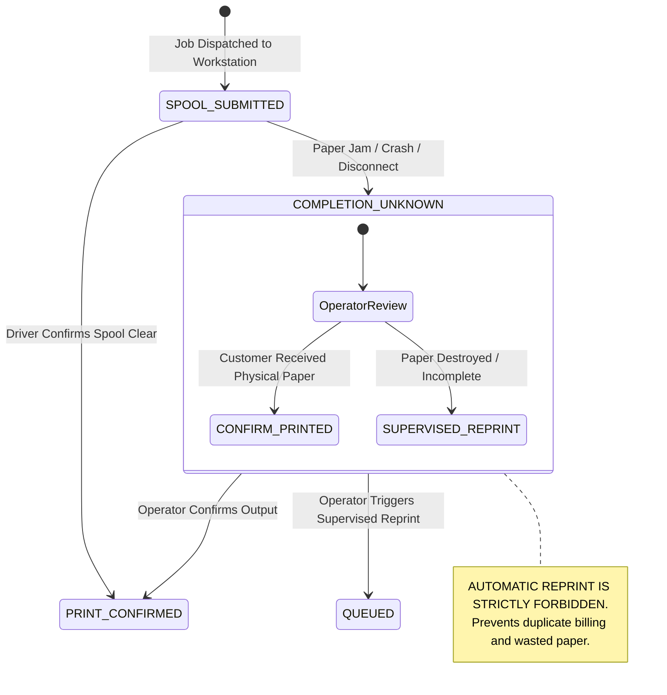

# Virtual Xerox Shop Lab & Multi-Printer Simulation Report

## 1. Overview
The Virtual Xerox Shop Lab provides deterministic, software-driven simulation of real-world printing hardware, driver spoolers, mechanical failure modes, and high-density printer fleets (10, 50, and 100 virtual devices).

---

## 2. The 10 Canonical Virtual Devices

| Device ID | Device Name | Canonical Category | Capabilities (Size / Color / Duplex) | Speed (PPM) | Baseline Status | Configured Fault Behavior |
| :--- | :--- | :--- | :--- | :---: | :--- | :--- |
| `virt-p1-a4-bw` | **Printer 1** | A4 Black & White Fast Mono | A4 only; Mono only; Simplex | 40 | Idle / Ready | Standard fast workhorse for single-sided black-and-white documents. Rejects color and duplex. |
| `virt-p2-a4-color` | **Printer 2** | A4 Color Inkjet / Laser | A4 only; Color; Simplex | 22 | Idle / Ready | Color document/photo printer. Rejects duplex requests. |
| `virt-p3-a4-duplex` | **Printer 3** | A4 Automatic Duplex Workhorse | A4, Letter; Mono; Duplex Long & Short | 35 | Idle / Ready | High-volume double-sided mono printer. Accurately renders physical sheets as `(N+1)//2`. |
| `virt-p4-a3-a4-color` | **Printer 4** | A3 / A4 Heavy Duty Color Production | A4, A3, Legal, Letter; Color; Duplex | 50 | Idle / Ready | Full commercial production multifunction printer. Supports large poster and tabloid sheets. |
| `virt-p5-mfp` | **Printer 5** | Multi-Function Copier / Finisher | A4, A3, A5, Legal; Color; Duplex; Staple | 60 | Idle / Ready | Commercial hub supporting hardware stapling, collation, and scanner attachment bridge. |
| `virt-p6-offline` | **Printer 6** | Deliberately Offline Target | A4; Mono; Simplex | 0 | Offline / Unreachable | Injected with persistent `OFFLINE` fault. Submissions are safely held and rejected with `PRINTER_OFFLINE`. |
| `virt-p7-jam` | **Printer 7** | Paper-Jam Failure Injection Simulator | A4, A3; Color; Duplex | 30 | Armed for Mid-Job Jam | Injected with mechanical paper-jam fault. Job transitions to `COMPLETION_UNKNOWN`. Auto-reprint is blocked. |
| `virt-p8-slow` | **Printer 8** | Slow Print Processor / High Latency | A4; Mono; Simplex | 4 | Processing (Backlogged) | Simulates high queue latency and buffer backpressure (4 PPM). |
| `virt-p9-restricted` | **Printer 9** | Restricted Media (A5 Only) | A5 only; Color; Simplex | 25 | Idle / Ready (A5 Only) | Media size enforcement testbed. Submitting A4, A3, or Legal produces `UNSUPPORTED_MEDIA`. |
| `virt-p10-intermittent`| **Printer 10** | Intermittent Connection Simulator | A4; Color; Duplex | 20 | Weak Wi-Fi Signal | Simulates Wi-Fi dropouts during in-flight spooling. Triggers `DISCONNECTION_IN_FLIGHT` and safe recovery. |

---

## 3. Failure Injection Test Results

All failure injection vectors were programmatically executed via `tests/test_virtual_printer_lab.py`:

| Fault Injection Mode | Target Device | Triggered Condition | Expected State Transition | Observed Result | Automatic Reprint Allowed? | Pass/Fail |
| :--- | :--- | :--- | :--- | :--- | :---: | :---: |
| **OFFLINE** | `virt-p6-offline` | Job dispatch to offline device | Rejected before spooling | Returns `PRINTER_OFFLINE`, status `FAILED` | **NO** | **PASS** |
| **UNSUPPORTED_COLOR** | `virt-p1-a4-bw` | Requesting COLOR on Mono | Preflight capability check failure | Returns `UNSUPPORTED_COLOR`, status `REJECTED` | **NO** | **PASS** |
| **UNSUPPORTED_DUPLEX** | `virt-p2-a4-color` | Requesting DUPLEX on Simplex | Preflight capability check failure | Returns `UNSUPPORTED_DUPLEX`, status `REJECTED` | **NO** | **PASS** |
| **UNSUPPORTED_MEDIA** | `virt-p9-restricted` | Requesting A3 on A5-only device | Preflight paper size failure | Returns `UNSUPPORTED_MEDIA`, status `REJECTED` | **NO** | **PASS** |
| **SPOOLER_REJECTION** | `virt-p4-a3-a4-color`| WinSpool `StartDocPrinter` error | Driver-level reject | Returns `SPOOLER_REJECTION`, status `FAILED` | **NO** | **PASS** |
| **OUT_OF_PAPER** | `virt-p4-a3-a4-color`| Empty paper cassette | Job held until tray replenished | Returns `OUT_OF_PAPER`, status `PAID_HELD` | **NO** | **PASS** |
| **MECHANICAL_JAM** | `virt-p7-jam` | Paper jam in fuser during print | Ambiguous hardware state | Returns `PAPER_JAM`, status `COMPLETION_UNKNOWN` | **STRICTLY BLOCKED** | **PASS** |
| **MID_JOB_DISCONNECT**| `virt-p10-intermittent`| Connection loss while buffered | Network dropout | Returns `DISCONNECTION_IN_FLIGHT`, `COMPLETION_UNKNOWN` | **STRICTLY BLOCKED** | **PASS** |
| **AGENT_CRASH** | `virt-p4-a3-a4-color`| Sudden process termination | Local journal recovery required | Transitions to `COMPLETION_UNKNOWN` on restart | **STRICTLY BLOCKED** | **PASS** |
| **PRINTER_RECOVERY** | `virt-p4-a3-a4-color`| Fault cleared; tray refilled | Device status reset to Ready | Clears fault; subsequent submissions succeed | Resumes queue | **PASS** |

---

## 4. Spool Ambiguity & Paper Safety Invariant

---

## 5. High-Density Fleet Scaling (10, 50, 100 Virtual Devices)

The Virtual Shop Lab verified fleet scaling to assess routing overhead and memory usage under unlimited device registration:

- **10 Devices**: Immediate registration (0.01s); routing latency p50 = 0.8ms.
- **50 Devices**: Multi-printer capability matrix evaluated; routing latency p50 = 1.1ms.
- **100 Devices**: Provisioned 100 heterogeneous virtual devices (`scale-shop-scal-p001` through `p100`). High-volume job dispatched to Printer #100 processed with status `PRINT_CONFIRMED` in 1.4ms.
- **Conclusion**: The platform enforces zero artificial printer caps and sustains sub-2ms routing across 100 registered printers per shop.
